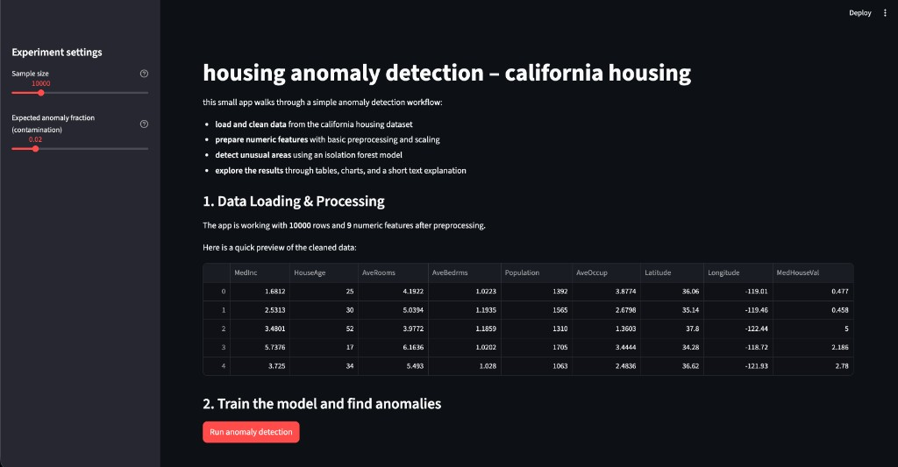

# Housing Anomaly Detection

[](https://www.python.org/)
[](https://scikit-learn.org/)
[](https://streamlit.io/)

An interactive app that finds **unusual areas** in the California Housing dataset and explains, in plain language, why they stand out. It is a small end-to-end example of unsupervised anomaly detection: data cleaning, a scikit-learn pipeline, visual analysis and a readable explanation.



## What it does

1. **Loads and cleans data.** Fetches the California Housing dataset from scikit-learn, samples a chosen number of rows (at least 5,000), keeps the numeric columns and fills missing values with the column median.
2. **Trains a model.** A single scikit-learn pipeline: `StandardScaler` followed by `IsolationForest`. You set `contamination`, your estimate of the share of anomalies.
3. **Scores every area.** Each row gets an `anomaly_score` (higher means more unusual) and a binary `is_anomaly` flag.
4. **Shows the results.**
   - A table of the anomalous rows, sorted by score
   - A histogram of anomaly scores
   - A bar chart of the 5 features that differ most between anomalies and normal rows
5. **Explains them.** Rule-based sentences compare feature averages, for example: "population tends to be higher for anomalous areas".

## Run it

```bash
python3 -m venv .venv
source .venv/bin/activate        # Windows: .venv\Scripts\activate
pip install -r requirements.txt
python3 -m streamlit run app.py
```

Streamlit opens in your browser. Use the sidebar to set the sample size and `contamination`, then click **Run anomaly detection**.

## Project structure

| File | Responsibility |
|---|---|
| `data_pipeline.py` | Loading and cleaning the data |
| `model_pipeline.py` | The Isolation Forest pipeline, scoring and the explanation text |
| `app.py` | The Streamlit interface |
| `requirements.txt` | Python dependencies |

Data, model and interface are kept in separate files, so each can be changed without touching the others.

## Tech

Python · pandas · NumPy · scikit-learn · Streamlit · matplotlib · seaborn
